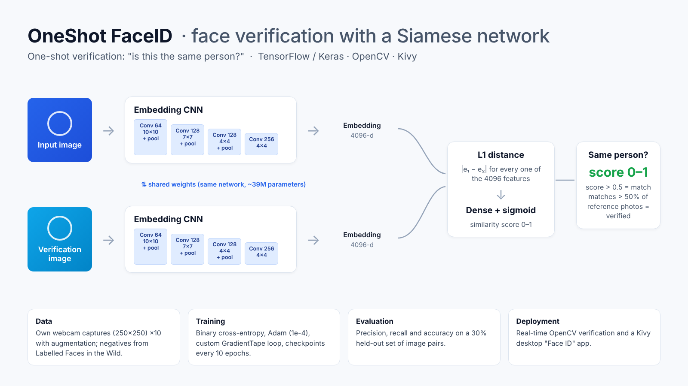

# Face Verification with a Siamese Neural Network

A Face ID–style app that answers one question: **is the person in front of the camera the same person as in the reference photos?**
It is built from the paper *Siamese Neural Networks for One-shot Image Recognition* (Koch, Zemel & Salakhutdinov, 2015) and implemented end to end in TensorFlow/Keras: data collection from a webcam, a custom training loop, evaluation, real-time verification with OpenCV and a Kivy desktop app.



## Why a Siamese network?

A normal classifier needs many photos of every person and must be retrained when a new person is added.
A Siamese network learns a **similarity function** instead: it compares two images and outputs how likely they show the same face.
That makes it a good fit for verification (one person, a few reference photos), the same problem phone unlock solves.

## How it works

| Step | What happens |
|---|---|
| **Data** | *Anchor* and *positive* images: my own face from the webcam, cropped to 250×250. *Negative* images: other people from Labelled Faces in the Wild (LFW). |
| **Pairs** | (anchor, positive) → label 1, (anchor, negative) → label 0; 70% train / 30% test. |
| **Embedding** | A shared CNN (4 convolution blocks, ~39M parameters) turns each 100×100 image into a 4096-d vector. |
| **Distance** | A custom `L1Dist` layer takes the absolute difference of the two embeddings. |
| **Decision** | A dense sigmoid unit converts the distance into a similarity score between 0 and 1. |
| **Training** | Binary cross-entropy, Adam (lr = 1e-4), custom `tf.GradientTape` loop, checkpoints every 10 epochs. |
| **Verification** | The live frame is compared with 30–50 reference photos. A pair matches when its score > 0.5; the person is verified when more than 50% of pairs match. |

## Project structure

```
├── src/
│   ├── config.py      # paths and hyper-parameters (relative, OS-independent)
│   ├── model.py       # embedding CNN, L1Dist layer, Siamese model, loader
│   ├── data.py        # LFW import, webcam crop, tf.data pipeline
│   ├── collect.py     # webcam capture: a = anchor, p = positive, q = quit
│   ├── train.py       # training loop + precision / recall / accuracy on the test set
│   └── verify.py      # real-time verification with OpenCV (v = verify)
├── app/faceid.py      # Kivy desktop "Face ID" app
├── notebooks/facial_verification.ipynb   # full walkthrough
└── docs/architecture.png
```

## Run it

```bash
pip install -r requirements.txt

# 1. Negatives: download LFW, unzip it, then in the notebook call move_lfw_to_negatives()
# 2. Positives and anchors from your webcam
python -m src.collect
# 3. Train and evaluate (prints precision, recall and accuracy on the held-out pairs)
python -m src.train --epochs 50
# 4. Copy 30–50 positive images to application_data/verification_images, then
python -m src.verify        # OpenCV window, press v
python -m app.faceid        # Kivy desktop app
```

## What I fixed while building it

Working through the tutorial on Windows taught me more than the happy path did:

- **Hard-coded Windows paths and shell commands** (`!rm`, `!unzip`) broke outside Colab, so all paths now live in `config.py` and are built with `pathlib`.
- **Negative images were never matched**: `list_files(NEG_PATH)` was missing the `*.jpg` pattern.
- **Images were decoded twice**: `preprocess` was mapped on the file lists and again inside `preprocess_twin`. Now decoding happens once, after the pairs are zipped.
- **Webcam keys were read twice per frame** (`cv2.waitKey` called in every `if`), so key presses were lost. The key is read once.
- **Evaluation used one batch of 16 pairs.** Precision, recall and accuracy are now computed over the whole test set.
- **Keras 3 compatibility**: the distance layer accepts list-wrapped tensors, and the model is saved in the `.keras` format and reloaded with `custom_objects`.

## Privacy

Face images, the LFW dataset and trained weights are **not** in this repository (`.gitignore`). To reproduce, collect your own anchor and positive images.

## Credits

- G. Koch, R. Zemel, R. Salakhutdinov (2015). *Siamese Neural Networks for One-shot Image Recognition*. ICML Deep Learning Workshop.
- Nicholas Renotte, *Build a Deep Facial Recognition App* (YouTube series): the tutorial this project follows and extends.
- Labelled Faces in the Wild, University of Massachusetts Amherst.
